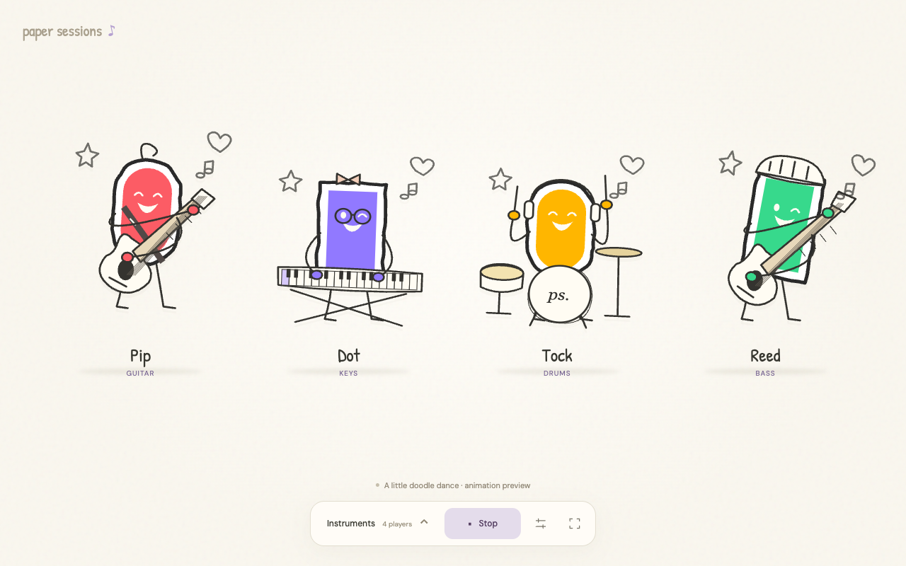

# Find the Beat



An experimental AI band that writes accompaniment for your music. Play an instrument, share browser audio, or choose a recording. An animated paper band performs the generated parts while the app displays their notation.

The composer receives measured pitch and rhythm information and writes ABC notation. The browser turns that notation into sampled instrument audio. This is a local Node.js app; it does not need a build step.

## Quick start

You need **Node.js 22 or newer**, npm, and a browser with Web Audio support. Chrome is recommended for sharing tab audio.

```sh
npm ci
cp .env.example .env.local
```

Edit `.env.local` and set `OPENROUTER_API_KEY` to a regular OpenRouter inference key. Management keys cannot generate music. The example selects `google/gemini-3.8-flash`; model access and API credits are required.

```sh
npm start
```

Open **http://localhost:4318**. Keep the server running while you use the app. API requests may incur charges on your provider account.

## Play with the band

1. Open **Instruments** and select the band members you want. Start with one or two so their parts are easy to hear.
2. Open settings and choose **Microphone**, **Browser tab**, or **Audio recording**.
3. Pick a musical style, or write your own direction. Leave tempo on Auto, or enter a tempo between 45 and 200 BPM.
4. Press **Start**. Microphone and tab sessions listen for about five seconds before requesting accompaniment. For tab audio, enable **Share tab audio** in the browser's sharing dialog.
5. Press the same transport button to stop. Start a new session after changing providers or updating the composition prompt.

Use headphones for the band output so it does not feed back into the microphone. If you play a song from your phone, place its speaker near the computer microphone and select Microphone. A clear solo instrument is easier to analyze than a full mix.

**Audio recording** prepares accompaniment before playing the source continuously. Preparation takes longer, but the source and band share one audio clock. **Preview band** auditions the selected sampled instruments without composing from your input. **Preview animations** only shows the characters moving.

Styles guide the arrangement; they do not change an instrument's sample patch. Guitar uses a nylon acoustic sound, Keys uses electric piano, and each of the ten instruments has a fixed soundfont patch.

## Configuration

Keep local settings in `.env.local`, which is ignored by Git. See [`.env.example`](.env.example).

- `MUSIC_PROVIDER`: `openrouter` or `codex`. If omitted, the server uses Codex.
- `OPENROUTER_API_KEY`: server-side inference key for OpenRouter.
- `OPENROUTER_MODEL`: OpenRouter model ID; defaults to `google/gemini-3.8-flash`.
- `BEAT_PORT`: local port; defaults to `4318`.
- `BEAT_DIAGNOSTICS=1`: additionally saves captured WAV windows and detailed scheduling diagnostics. Off by default.
- `CODEX_PATH`: optional executable path when using the Codex provider.
- `BEAT_TEST=1`: enables the developer recording harness at `/one-minute-test` and its restricted artifact writer.

To use the alternative Codex provider, install and sign into the Codex CLI, then set `MUSIC_PROVIDER=codex`. That provider uses the configured `gpt-6.1-sol` model through the signed-in app-server. There is no automatic fallback between providers.

The server binds to `127.0.0.1` and accepts local browser origins. It is intended for local use, not a public hosted service.

## How it works

- **Capture and analysis:** an AudioWorklet captures input. A worker extracts pitch-class energy, spectral peaks, onsets, and approximate monophonic note events.
- **Composition:** the server passes all measured frames and events to the selected model. Confidence fields are removed from composer-facing input. Instructions ask the parts to follow the source's melody, harmony, accents, and phrase changes.
- **Streaming:** the model emits ABC sections, which are parsed into playable notes and streamed to the browser. No canned accompaniment fills model stalls. The app does not add musical variation by rewriting generated notes after composition; notation parsing and playback bounds still apply.
- **Playback:** Web Audio schedules sampled instruments. Live entries can align to a detected pulse; recording mode prepares the full accompaniment and source on a shared timeline.
- **Continuity:** each listening session retains musical context until Stop. OpenRouter cannot accept new observations inside an active HTTP request, so observations captured during generation are included in the next request. Codex supports steering its active turn.

Instrument samples load from the FluidR3_GM soundfont hosted at `paulrosen.github.io`. Network access is needed for samples and the selected model provider.

## Project layout

```text
server.mjs                 Local HTTP entry point, routes, provider selection
src/server/
  abc.mjs                  ABC parsing and streamed-section validation
  context.mjs              Composer input construction
  input-score.mjs          Measured-note notation and confidence removal
  music-prompt.mjs          Shared composition instructions
  openrouter.mjs           OpenRouter streaming provider and session history
  composer.mjs             Alternative Codex app-server provider
  sse.mjs                  Streaming event decoder
  diagnostics.mjs          Optional captured-audio diagnostics
  session-archive.mjs      Local append-only session archives
public/                    Browser UI, analysis workers, audio, and notation
public/vendor/paper-doodle/ Animated character rendering and reactions
public/assets/             Active character geometry and attribution
tests/                     Unit and provider-contract tests
tests/browser/             Browser audio checks and recording harness
scripts/check.mjs          Syntax and local-import checks
docs/                      Developer testing and asset credits
diagnostics/               Generated local data; ignored by Git
```

## Development

```sh
npm run check
npm run format:check
npm test
```

Use `npm run format` to format source, tests, and documentation. CI runs the same static checks and unit tests without an API key. Browser checks cover audio output, errors, and UI behavior; see [testing instructions](docs/testing.md).

## Diagnostics and privacy

API keys stay on the Node server. Original input audio is not sent to the composition model; measured musical evidence is sent instead.

Every session writes an append-only archive under `diagnostics/sessions/`. Archives include model inputs, generated notation, timing, errors, and playback reports. Raw input WAV files are saved only when `BEAT_DIAGNOSTICS=1`. All diagnostics are local and ignored by Git, but may contain details of your performance or recording.

Useful local endpoints are `/health`, `/composer-status`, `/playback-status`, `/sessions`, and `/sessions/<session-id>`. The settings menu also exposes Audio status. Deleting `diagnostics/` removes saved local sessions; stop the server first.

## Troubleshooting

- **401 from OpenRouter:** check that the key is a regular inference key and is active. A management key can pass account lookups while generation fails.
- **402 from OpenRouter:** check available credits and key spending limits.
- **No sound:** click Enable audio if shown, check band and instrument volumes, and inspect Audio status. Sample loading needs network access.
- **No tab input:** select a browser tab and enable audio sharing; support depends on the browser and operating system.
- **Another session is active:** stop the other tab's session, or restart the server.
- **Recording tempo is unclear:** enter a manual tempo and restart.
- **Repetitive or mismatched music:** try a clear solo source and a smaller band. Check the captured input and generated notation before assuming the renderer is at fault.

## Current limits

This is a prototype, not a reliable transcription system or a replacement for a live musician. Analysis works best on clear single-note input. Full mixes, polyphonic guitar, rubato, and noisy microphone audio are harder. The transport uses 4/4; pulse alignment is not reliable downbeat detection. Live generation can lag musical changes, and model or sample-loading delays can create gaps. Fixed soundfont samples also limit articulation and sustained notes.

Passing tests establishes specific software behavior, not musical quality. Generated accompaniment still needs listening evaluation with the source.

Character bodies are adapted from Kenney's CC0 Scribble Platformer assets. See [asset credits](docs/credits.md) and the retained source license.
